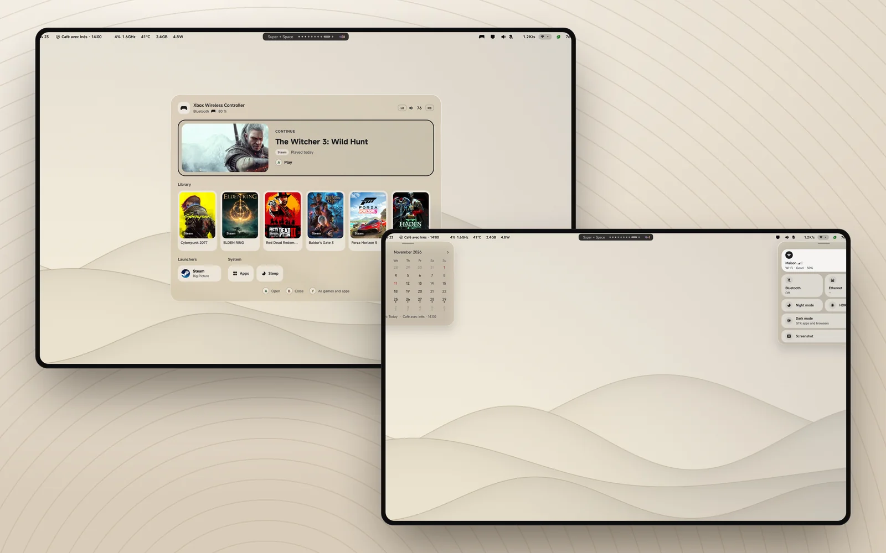

# coucou-shell

A Fedora desktop built on [Hyprland](https://hyprland.org/), with its own bar, its own tools, and a manager that installs it and keeps it up to date.

<picture><source media="(prefers-color-scheme: dark)" srcset="docs/screenshots/showcase-dark.webp"></picture>

**Documentation and video: https://lucasssoh.github.io/dotfiles/**

## Install

On Fedora 44 or 45. A minimal netinstall is enough.

```bash
sudo dnf config-manager addrepo --from-repofile=https://lucasssoh.github.io/dotfiles/coucou-shell.repo
sudo dnf install cc-pkg-mng
cc-pkg-mng init
```

Then, day to day:

```bash
cc-pkg-mng upgrade    # move to the latest release and apply it
cc-pkg-mng status     # check that everything is in place
```

## Made for coucou-shell

| Tool | What it does |
|---|---|
| [**The bar**](docs/bar/index.md) | Clock and agenda, the machine's figures, workspaces and music, and a drawer for the network, sound, power and notifications |
| [**Roue**](docs/tools/roue.md) | A radial wheel: press, aim, let go |
| [**Prisme**](docs/tools/prisme.md) | The wallpaper picker, with light and dark pairs |
| [**Balise**](docs/bar/balise.md) | Wi-Fi, Bluetooth, Ethernet and screen settings, from the bar |
| [**Manette**](docs/tools/manette.md) | Games, on the controller's Guide button |
| [**Sésame**](docs/tools/sesame.md) | One card for every password asked outside a terminal |
| [**Liseuse**](docs/tools/liseuse.md) | A reading library on one key |
| [**cc-pkg-mng**](docs/cc-pkg-mng.md) | Installs the picked parts, and moves between releases |


## Documentation

| Page | Contents |
|---|---|
| [**Installation**](docs/installation.md) | Installing with dnf, the questions `init` asks, unattended installs |
| [**cc-pkg-mng**](docs/cc-pkg-mng.md) | Commands, channels, upgrading and rolling back |
| [**Settings**](docs/configuration.md) | Where each setting lives, and how to keep a change through an upgrade |
| [**Key bindings**](docs/keybindings.md) | Every shortcut, on an AZERTY keyboard |
| [**Units**](docs/units.md) | Every part of coucou-shell, with its guide |
| [**Hardware**](docs/hardware.md) | CPU and GPU profiles, codecs, what's left to do by hand |
| [**Changelog**](CHANGELOG.md) | What changed in each release |

## Tested on

| Machine | |
|---|---|
| Lenovo IdeaPad Slim 5 14IMH10 | Intel, OLED panel, with an external screen |
| Asus TUF A15 | AMD |

Other machines get their drivers from the same [detection](docs/hardware.md).

## Licences

coucou-shell is under a [personal use licence](LICENSE.md). All rights reserved.

| ✓ Allowed | ✗ Not allowed without written permission |
|---|---|
| Installing and using coucou-shell on personal machines | Redistributing it, modified or not |
| Changing it for personal use | Selling it, or building a product or service on it |
| Sharing screenshots, writing about it, linking to it | Naming another project after it |

This table is a summary: [LICENSE.md](LICENSE.md) is what applies.

Third-party material keeps its own licence:

| Material | Licence | Details |
|---|---|---|
| Balise's network logic, adapted from Orbit | MIT | [THIRD-PARTY.md](THIRD-PARTY.md) |
| MingCute icons, in Roue | Apache 2.0 | [THIRD-PARTY.md](THIRD-PARTY.md) |
| Console font, from JetBrains Mono | SIL OFL 1.1 | [THIRD-PARTY.md](THIRD-PARTY.md) |
| Heroic and Lutris logos | CC0 1.0; trademarks of their owners | [THIRD-PARTY.md](THIRD-PARTY.md) |
| GNOME wallpapers | CC BY-SA 3.0 US | [wallpapers/CREDITS.md](wallpapers/CREDITS.md) |
| Music of the presentation video: "December Dream", Fourplay | © its rights holders. Not part of this repository | |

The Aube and Nuit wallpapers are coucou-shell's own, under its licence. Fonts, icon fonts and packages are downloaded at install and aren't redistributed here.
