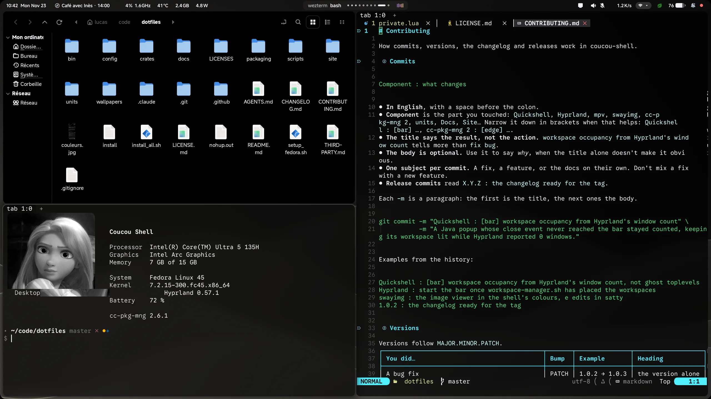

# coucou-shell

<p align="center">
  <a href="#install"></a>
  <a href="https://fedoraproject.org/"></a>
  <a href="https://github.com/lucasssoh/dotfiles/releases/latest"></a>
  <a href="https://lucasssoh.github.io/dotfiles/"></a>
  <a href="LICENSE"></a>
</p>
<p align="center">
  <a href="https://hypr.land/"></a>
  <a href="https://www.rust-lang.org/"></a>
  <a href="https://quickshell.org/"></a>
  <a href="https://www.gtk.org/"></a>
  <a href="https://mpv.io/"></a>
  <a href="https://pipewire.org/"></a>
</p>

A desktop built on [Hyprland](https://hyprland.org/) and [Quickshell](https://quickshell.org/), with its own bar, its own tools, and a manager that installs it and keeps it up to date.

<picture><source media="(prefers-color-scheme: dark)" srcset="docs/screenshots/showcase-dark.webp"></picture>

**Documentation and video: https://lucasssoh.github.io/dotfiles/**

## Install

On Fedora 44 or 45. A minimal netinstall is enough.

```bash
sudo dnf config-manager addrepo --from-repofile=https://lucasssoh.github.io/dotfiles/coucou-shell.repo
sudo dnf install cc-pkg-mng
cc-pkg-mng init
```

Then, day to day:

```bash
cc-pkg-mng upgrade    # move to the latest release and apply it
cc-pkg-mng status     # check that everything is in place
```

## Made for coucou-shell

| Tool | What it does |
|---|---|
| [**The bar**](docs/bar/index.md) | Clock and agenda, the machine's figures, workspaces and music, and a drawer for the network, sound, power and notifications |
| [**Roue**](docs/tools/roue.md) | A radial wheel: press, aim, let go |
| [**Prisme**](docs/tools/prisme.md) | The wallpaper picker, with light and dark pairs |
| [**Balise**](docs/bar/balise.md) | Wi-Fi, Bluetooth, Ethernet and screen settings, from the bar |
| [**Manette**](docs/tools/manette.md) | Your games, on the controller's Guide button |
| [**Antenne**](docs/apps/antenne.md) | Free TV channels with a guide, and the shows you follow |
| [**Sésame**](docs/tools/sesame.md) | One card for every password asked outside a terminal |
| [**Liseuse**](docs/tools/liseuse.md) | A reading library on one key |
| [**cc-pkg-mng**](docs/cc-pkg-mng.md) | Installs the parts you pick, and moves between releases |



## Documentation

| Page | What you'll find |
|---|---|
| [**Installation**](docs/installation.md) | Installing with dnf, the questions `init` asks, unattended installs |
| [**cc-pkg-mng**](docs/cc-pkg-mng.md) | Commands, channels, upgrading and rolling back |
| [**Your settings**](docs/configuration.md) | Where each setting lives, and how to keep a change through an upgrade |
| [**Key bindings**](docs/keybindings.md) | Every shortcut, on an AZERTY keyboard |
| [**Units**](docs/units.md) | Every part of coucou-shell, with its guide |
| [**Hardware**](docs/hardware.md) | CPU and GPU profiles, codecs, what's left for you to do by hand |
| [**Changelog**](CHANGELOG.md) | What changed in each release |

## Licences

coucou-shell is free software, under the [GPL-3.0](LICENSE) or any later version. You can use, change and share it, as long as what you share stays under the same licence and keeps its credits. The coucou wallpapers and the coucou bird are under [CC BY-SA 4.0](LICENSES/CC-BY-SA-4.0.txt).

Forks are welcome, under a name of their own.

What isn't mine keeps its own licence:

| Material | Licence | Details |
|---|---|---|
| Balise's network logic, adapted from Orbit | MIT | [THIRD-PARTY.md](THIRD-PARTY.md) |
| MingCute icons, in Roue | Apache 2.0 | [THIRD-PARTY.md](THIRD-PARTY.md) |
| Console font, from JetBrains Mono | SIL OFL 1.1 | [THIRD-PARTY.md](THIRD-PARTY.md) |
| Heroic and Lutris logos | CC0 1.0; trademarks of their owners | [THIRD-PARTY.md](THIRD-PARTY.md) |
| GNOME wallpapers | CC BY-SA 3.0 US | [wallpapers/CREDITS.md](wallpapers/CREDITS.md) |
| Films in Antenne's screenshots: Big Buck Bunny, Caminandes and the other Blender Foundation open movies | CC BY 3.0 and 4.0, © Blender Foundation | [blender.org](https://studio.blender.org/films/) |
| Wallpaper of the presentation video: Pepper&Carrot, David Revoy | CC BY 4.0 | [peppercarrot.com](https://www.peppercarrot.com/) |
| Music of the presentation video: "Sunday Smooth", Scott Buckley | CC BY 4.0 | [scottbuckley.com.au](https://www.scottbuckley.com.au/library/sunday-smooth/) |

Fonts, icon fonts and packages are downloaded at install and aren't redistributed here.
