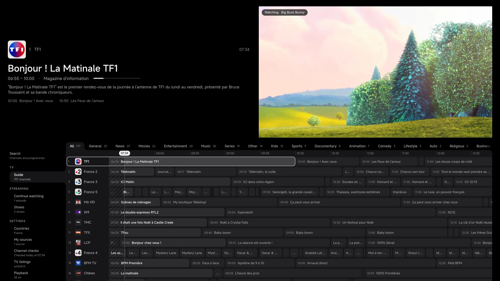
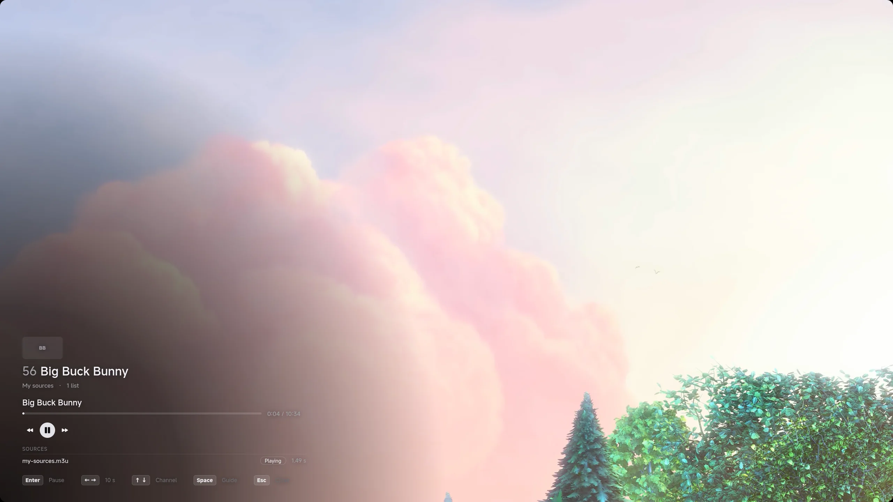
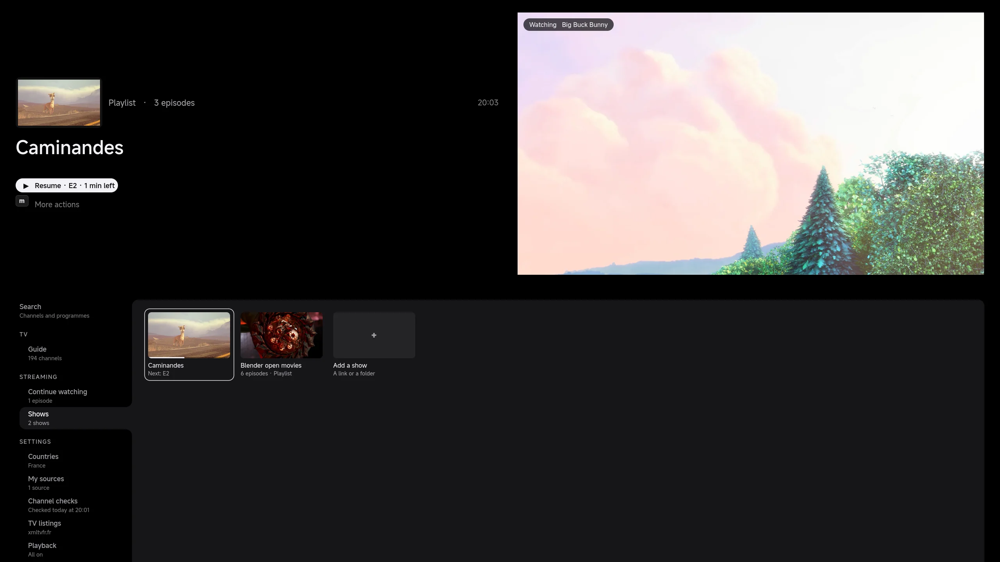

# Antenne

The TV. Free channels from the countries you pick, with a programme guide, your own playlists and streams, and shows from YouTube, the Internet Archive or your own files.

`Super + G` opens it, full screen, on the channel you watched last. If it's open on another workspace, `Super + G` brings it to yours. Once it's in front, `Super + G` opens the guide.



## Watching

When you change channel or move the pointer, the channel's name and programme show for a moment at the bottom left. `Space` keeps them on screen with more detail. Press it again for the guide, and once more to come back to the picture.

While a channel loads, the picture dims and a ring turns in the middle. If a channel doesn't answer, Antenne says so in the middle of the screen and offers to try again, to go back to the channel you were watching, or to open the guide.



## The guide

The lower half of the screen holds a menu on the left and the page you pick on the right:

- **Search** finds channels by name, number or category, and programmes still to come. Below your channels, it lists the ones from countries you haven't added. Paste a link to play it once, or to keep it.
- **Guide** shows the channels in rows and the programmes in time, by category. Past programmes are hatched. `Enter` on a programme still to come sets a reminder: when it starts, a card offers to switch to it.
- **Continue watching** and **Shows**: see [Shows](#shows).
- **Settings**: see [Settings](#settings).

## Shows

**Shows** holds the series you follow, and **Continue watching** the episodes you started. Antenne remembers where each episode stopped. When an episode reaches its credits, the next one shows at the bottom right and starts at the end, unless you press `Esc`. After three episodes in a row without a key pressed, Antenne asks whether you're still watching.



To add one, pick **Add a show** and paste a link or a path:

| What you add | Its seasons |
|---|---|
| A YouTube channel, like `youtube.com/@name` | Its playlists. When some of them say they hold full episodes, only those are kept |
| A YouTube playlist | One season |
| An M3U playlist (`.m3u`), as a link or a file | One season per `group-title` |
| A folder of videos | One season per sub-folder. Without sub-folders, one season |
| An Internet Archive or arte.tv collection | One season |

Antenne reads YouTube, the Internet Archive, arte.tv and the other sites [yt-dlp supports](https://github.com/yt-dlp/yt-dlp/blob/master/supportedsites.md). Shows are listed again once a day, for their new episodes.

In an M3U playlist, each entry is an episode:

```
#EXTM3U
#PLAYLIST:My show
#EXTINF:1320 group-title="Season 1" tvg-logo="https://example.org/s01e01.jpg",The first episode
https://example.org/s01e01.mp4
#EXTINF:-1 group-title="Season 1",The second episode
https://example.org/s01e02.mp4
```

- `#PLAYLIST` names the show. Without it, the show takes the file's name.
- `group-title` is the season. Episodes keep the order of the file.
- The number after `#EXTINF:` is the length in seconds, or `-1` when unknown.
- `tvg-logo` is the episode's picture, as a link or a file.

In a folder, the videos (`.mp4`, `.mkv`, `.webm`, `.avi`, `.mov`, `.m4v`, `.ts`, `.flv`, `.mpg`) are sorted by the number in their name: `Episode 2` comes before `Episode 10`.

`m` on a show or an episode opens its actions: mark it as watched or not, play it from the beginning, take it out of **Continue watching**, look for new episodes, or remove the show.

## Settings

| Page | What you set |
|---|---|
| **Countries** | The countries whose free channels fill the guide, from [iptv-org](https://github.com/iptv-org/iptv)'s lists |
| **My sources** | Your own playlists, streams and pages, by link or file |
| **Channel checks** | How often Antenne checks that each channel answers. A channel that doesn't answer leaves the guide until it does |
| **TV listings** | Where programme times come from: [xmltvfr.fr](https://xmltvfr.fr) for France |
| **Playback** | Open on the last channel, show channel logos, lower the quality on a weak connection, play the next episode automatically |

**My sources** takes a link to:

- an M3U playlist of channels (`.m3u`): its channels join the guide;
- a stream (`.m3u8`, `.mp4`, `rtsp://`, `udp://`, `srt://`…), a camera for example;
- a web page with a video, on a site yt-dlp supports.

A stream or a page becomes a channel of its own, in the **My sources** tab of the guide. Playlists and videos you put in `~/.config/antenne/playlists/` are added too.

Services that protect their video, such as Netflix or Disney+, can't play in Antenne.

## Keys

`:` (or `?`) shows every key, for the keyboard or the controller you're using.

| Keyboard | Controller | Does |
|---|---|---|
| `Space` | X | Details, then the guide, then the picture |
| `↑` `↓` | D-pad | The previous or next channel, or episode in a show |
| `0`–`9` | | A channel by its number |
| `Enter` | A | Choose. During a show: pause |
| `←` `→` | LB, RB | During a show: back or forward 10 seconds |
| `Shift` + `←` `→` | LT, RT | During a show: back or forward a minute |
| `Home` | | During a show: back to the beginning |
| `Esc` | B | Back |
| `/` | Y | Search |
| `s` | Start | Settings |
| `i` | | The channel's details |
| `f` | | Add or remove a favourite |
| `⌫` | | The channel you watched before |
| `Tab`, `Shift` + `Tab` | LB, RB | In the guide: the next or previous category |
| `m` | Start | In Shows: the actions |

The controller letters are an Xbox controller's: Antenne shows the labels of the controller in your hands. While Antenne is in front, it takes the controller, and its Guide button still opens the [controller menu](../tools/manette.md).

## Files

| File | Holds |
|---|---|
| `~/.config/antenne/settings.json` | The settings. Change them from **Settings** |
| `~/.config/antenne/library.json` | Your shows |
| `~/.config/antenne/playlists/` | Playlists and videos read as sources. `my-sources.m3u` holds the streams and pages you added |
| `~/.local/state/antenne/state.json` | Favourites, reminders, the last channel, where each episode stopped |
| `~/.cache/antenne/` | Channel lists, programme times, logos and pictures |
