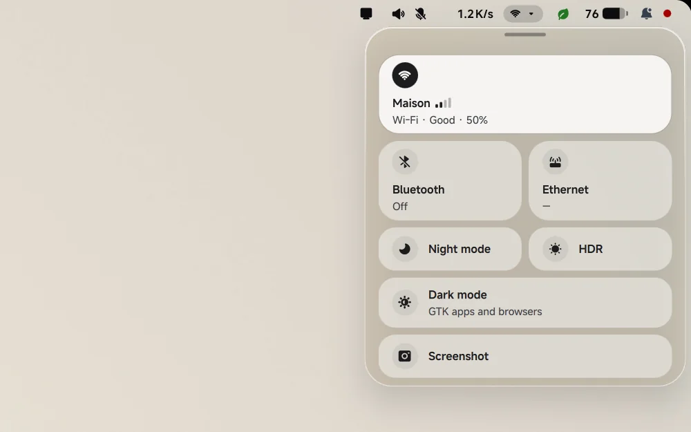

# Balise

Wi-Fi, Bluetooth, Ethernet and screen settings, in a drawer of the bar.

<picture><source media="(prefers-color-scheme: dark)" srcset="../screenshots/balise-dark.webp"></picture>

## Open it

Click the network icon, in the right-hand group of the bar. From a key or a script:

```bash
qs -c bar ipc call bar toggleBalise
```

## In the drawer

| Tile | Does |
|---|---|
| Wi-Fi | Lists the networks in range. Pick one to join it |
| Bluetooth | Lists your devices and the ones nearby |
| Ethernet | Shows the wired connection |
| Brightness | The slider on the right |
| Night mode | Warms the colours. Also on `Super + N`. See [displays](../session/displays.md#night-mode) |
| HDR | Turns HDR on or off for the screen the drawer is on. See [displays](../session/displays.md#hdr) |
| Dark mode | Switches the shell, GTK apps and browsers between light and dark. A light and dark [wallpaper](../session/wallpapers.md) follows |
| Screenshot | Takes one. See [Screenshot](../tools/screenshot.md) |

A setting that needs administrator rights asks for your password, on [Sésame](../tools/sesame.md)'s card.

## Share a Wi-Fi network

A saved network, as a QR code in the terminal:

```bash
balise wifi-share <ssid>
```

## Limits

Balise doesn't manage VPNs.
