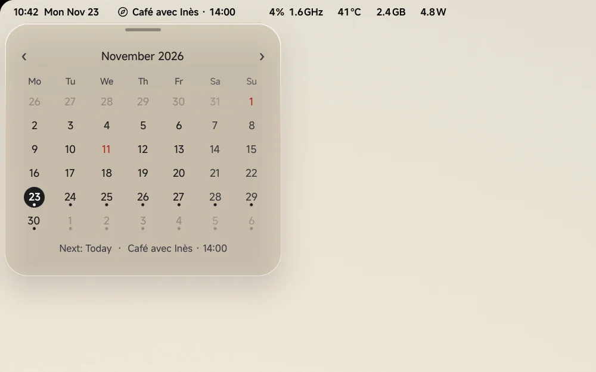

# Clock and agenda

The clock sits at the left of the bar. Click it for the calendar: the month, your agenda and your reminders.

<picture><source media="(prefers-color-scheme: dark)" srcset="../screenshots/calendar-dark.webp"></picture>

## Add or delete an event

Press `Super + A`. A list of your coming events opens.

- **To add one**, type it on one line and press `Enter`, then tick its reminders.
- **To delete one**, pick it in the list and confirm.

The line is read in French, in any order. What isn't a date, a time or a reminder is the title:

```
demain 14h30 Dentiste
ven 9h-10h Réunion !1j
```

| Part | Write |
|---|---|
| Date | `auj`, `demain`, `après-demain`, a day (`lun` to `dim`), `3/10`, `3/10/27`, `3 oct`, `le 3`, `dans 2h`, `dans 30min`, `dans 3j` |
| Time | `14h`, `14h30`, `14:30`, or a span, `14h-15h30`. One hour when you give no end; the whole day when you give no time |
| Reminder | `!15m`, `!1h`, `!1j`, `!3j`, `!1s` before, `!0` at the start. With one on the line, the reminder list is skipped |

Reminders ring in the bar, and the next event shows right of the clock.

## Calendars

There are three calendars:

| Calendar | Holds |
|---|---|
| `personal` | The events you add with `Super + A` |
| `etude` | [Programme](programme.md)'s study sessions |
| `cours` | Your courses, from Programme's timetable |

To add a calendar or change the date format, edit khal's [`config`](../../config/hyprland/khal/config).

## Try another time

To see the bar at another hour without waiting:

```bash
qs -c bar ipc call clock set "02:00"      # move the shell's clock
qs -c bar ipc call clock freeze "02:00"   # stop it there
qs -c bar ipc call clock reset            # back to the real time
```

The bar, the notification centre and the calendar follow.
