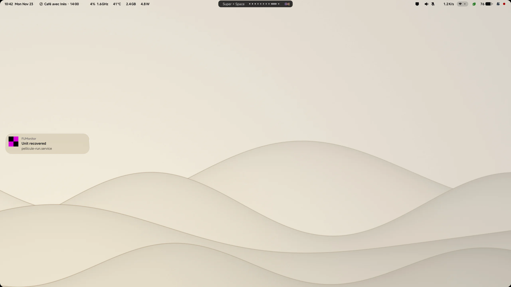

# The bar

The bar shows the time, the machine's figures, your workspaces and your open apps, and opens a drawer for everything you set often.

<picture><source media="(prefers-color-scheme: dark)" srcset="../screenshots/bar-dark.webp"></picture>

| Area | What's there |
|---|---|
| Left | The [clock](clock-agenda.md), then the [metrics](metrics.md): CPU, temperature, fan, memory, power draw. [Programme](programme.md) sits right of the clock when it's installed |
| Centre | The [island](island.md): the active window, your workspaces and what's playing |
| Launchers | Your [open apps](launchers.md) |
| Right | A [controller](../tools/manette.md) when one is connected, HDR, [audio](mixer.md) output and input, network rate, [Balise](balise.md), power profile, [battery](power.md), [notifications](notifications.md) |

Hold `Super` and the [key sheet](key-sheet.md) opens under the island. [Veille](veille.md) appears there late at night.

## Position

The bar sits at the top or at the bottom of the screen. Edit `~/.config/hypr/bar-position.json`:

```json
{ "position": "bottom" }
```

| Key | Values | Default |
|---|---|---|
| `position` | `top` or `bottom` | `top` |

The bar moves as soon as you save. This file is yours: an upgrade never replaces it.

## Zen mode

`Super + Z` hides the bar, and brings it back. Programme's reminders wait while it's hidden, and so does Veille unless you [set it otherwise](veille.md).

## From a key or a script

Every drawer opens with a command, so you can bind it to a key in [`private.lua`](../session/hyprland.md#your-own-rules-and-keys) or call it from a script:

```bash
qs -c bar ipc call bar toggleBalise
```

| Function | Does |
|---|---|
| `toggleCalendar` | Opens or closes the calendar |
| `toggleBalise` | Balise |
| `toggleMixer` | The mixer |
| `togglePower` | The power drawer |
| `toggleNotificationCenter` | The notification centre |
| `toggleProgramme` | Programme's drawer |
| `openLibrary` | Liseuse's library |
| `controllerMenu` | The controller menu |
| `toggleZen`, `setZen true`, `setZen false` | Zen mode |
| `setDnd true`, `setDnd false` | Do not disturb |

## Screen corners

The bar rounds the screen's four corners, in the same curve as the windows. A fullscreen window covers them, and they show in screenshots.

## Screenshots of your own setup

`qs -c bar ipc call demo on` shows made-up figures instead of yours: the time, the battery, the system figures, the next event, the Wi-Fi name and what's playing. `demo off` brings yours back, and closes the notifications received meanwhile.
