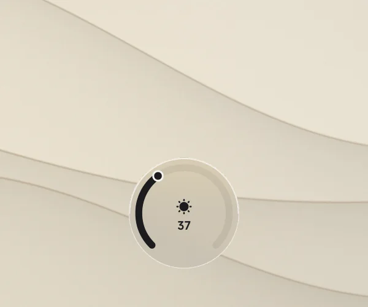

# Indicators

What shows when something changes: a level, HDR, a controller, a low battery.

## Volume, microphone and brightness

When you change one of them, a dial shows the level at the bottom of the screen.

<picture><source media="(prefers-color-scheme: dark)" srcset="../screenshots/osd-dark.webp"></picture>

Brightness never goes all the way to 0.

## HDR

`hdr` shows in the right-hand group while the screen is in HDR. Turn it on or off from [Balise](balise.md).

## Controller

A controller's silhouette shows in the right-hand group while one is connected, filled like a battery gauge. See [Manette](../tools/manette.md).

## Battery alert

At 20 %, 10 % and 5 % on battery. See [Power](power.md#battery-alert).
