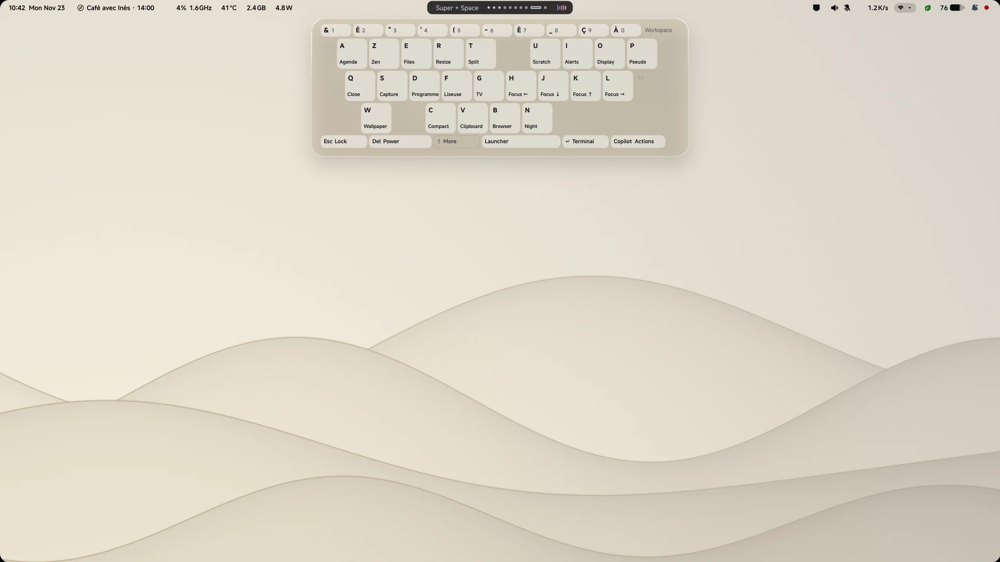
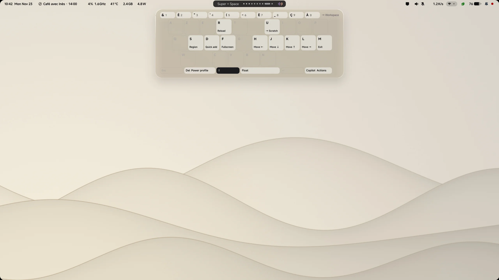

# Key sheet

Hold `Super`: a keyboard opens under the island and shows the keys that do something. Add `Shift` for the second layer. Let go and it closes.

<picture><source media="(prefers-color-scheme: dark)" srcset="../screenshots/keybinds-dark.webp"></picture>

<picture><source media="(prefers-color-scheme: dark)" srcset="../screenshots/keybinds-shift-dark.webp"></picture>

The sheet shows the bindings of [`keybinds.lua`](../../config/hyprland/hypr/keybinds.lua) that carry a `description`. Every binding is listed in [key bindings](../keybindings.md).
