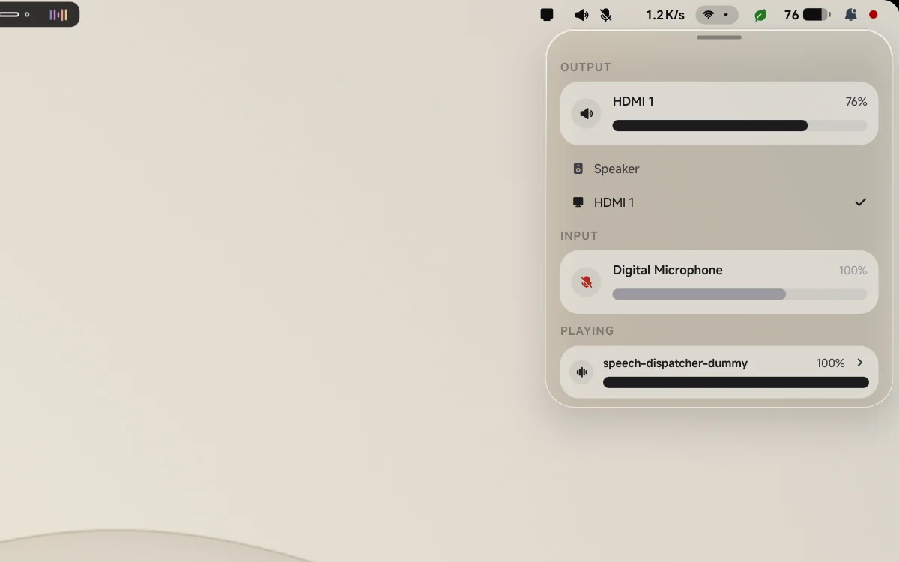

# Mixer and equalizer

Output and input levels, your audio devices, and a volume and an equalizer for each app.

<picture><source media="(prefers-color-scheme: dark)" srcset="../screenshots/mixer-dark.webp"></picture>

## Open it

Click the speaker or the microphone icon, in the right-hand group of the bar.

| On an audio icon | Does |
|---|---|
| Click | Opens the mixer |
| Scroll | Changes the level |
| Right-click | Opens pavucontrol, for card profiles and moving a stream to another device |

When you plug in a new output or input, it becomes the default.

## Equalizer

Each app has its own. Click the chevron on an app's row:

- five bands: 60 Hz, 250 Hz, 1 kHz, 4 kHz and 12 kHz;
- ten presets: Flat, Acoustic, Bass boost, Classical, Dance, Hip-hop, Jazz, Pop, Rock and Vocal;
- an on/off switch.

Four apps can have an equalizer at the same time.

Each app keeps its curve. To start again from flat everywhere, delete `~/.local/state/bar-equalizer.json`.

## Volume keys

The volume keys move in 5 % steps and stop at 100 %. A dial shows the level: see [indicators](indicators.md).

## Change the bands

See [audio](../session/audio.md).
