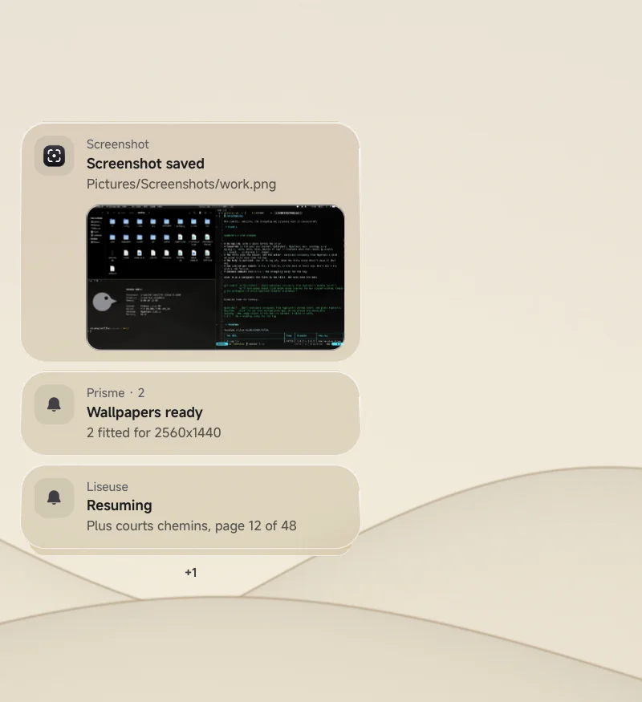
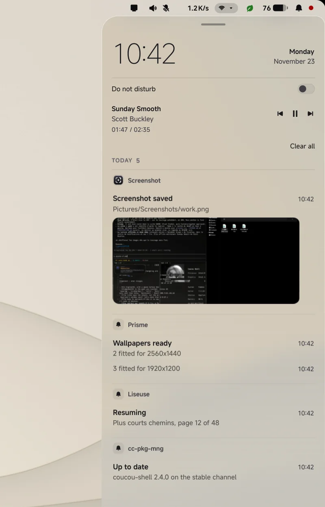

# Notifications

Pop-ups when a notification arrives, and a centre that keeps them.

## Pop-ups

<picture><source media="(prefers-color-scheme: dark)" srcset="../screenshots/toasts-dark.webp"></picture>

They show on the left, in the middle of the screen.

- A pop-up stays while the pointer is on it.
- Past three, the others wait underneath.
- Messages in a row from the same app and sender share one pop-up.
- `×` closes one. It shows when the pointer is on the pop-up.

## The centre

<picture><source media="(prefers-color-scheme: dark)" srcset="../screenshots/notifications-dark.webp"></picture>

Click the bell, or press `Super + I`. The centre is a panel down the right edge of the screen ([how it sits](island.md#its-look)): notifications grouped by app, under Today and Earlier, media controls, and Clear all.

## Do not disturb

Right-click the bell, or use the switch in the centre. Pop-ups stop; notifications still go to the centre.

```bash
qs -c bar ipc call bar setDnd true
```

Pop-ups also keep quiet while a book is open in [Liseuse](../tools/liseuse.md) and during a [Programme](programme.md) session.
