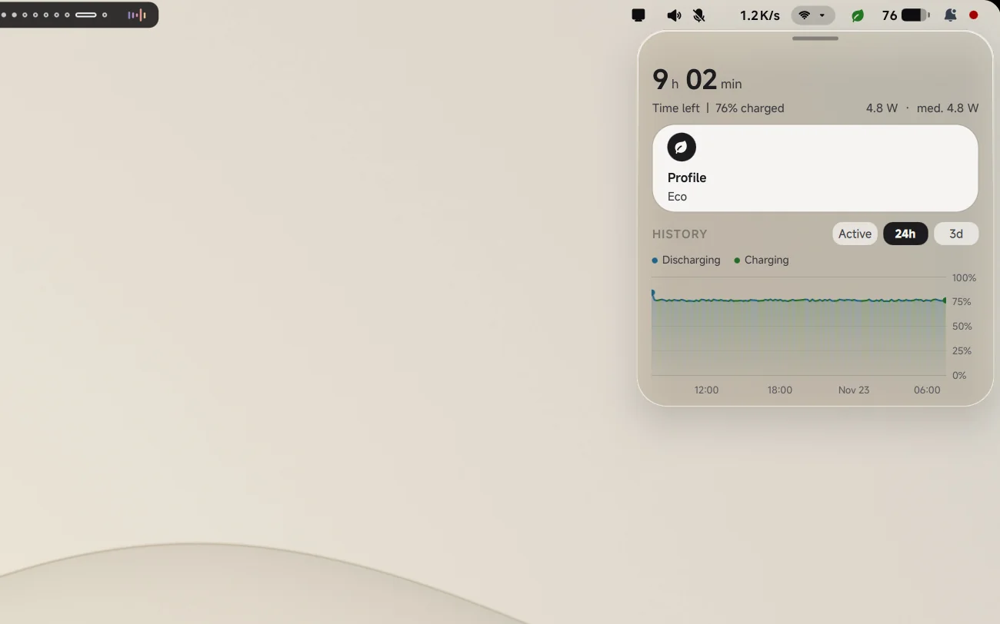
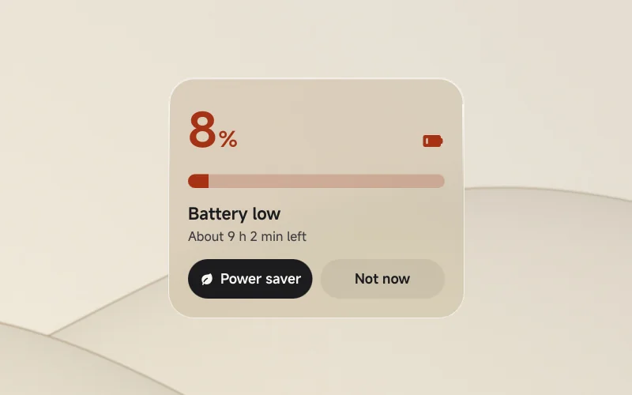

# Power

The battery, in the right-hand group of the bar, and its drawer.

<picture><source media="(prefers-color-scheme: dark)" srcset="../screenshots/power-dark.webp"></picture>

## The battery in the bar

An outlined battery with the charge inside. When the charge is limited, a dotted line marks where it stops.

## The drawer

Click the battery.

| Row | Does |
|---|---|
| Time left | Until empty, or until full while charging |
| Charge limit | Stops the charge at about 60 %, for a laptop that stays plugged in. Lenovo IdeaPads only |
| Fast charge | Lenovo IdeaPads only |
| Profile | Power saver, balanced or performance |
| History | The charge over the last hours |

## Power profile

The icon left of the battery opens the profile wheel. So does `Super + Shift + Delete`: see [Roue](../tools/roue.md).

## Battery alert

On battery, an alert shows at 20 %, 10 % and 5 %. Switch to the power saver profile from it, or dismiss it.

<picture><source media="(prefers-color-scheme: dark)" srcset="../screenshots/battery-alert-dark.webp"></picture>

## When idle

What the machine does when left idle, and after how long, is in [Hyprland](../session/hyprland.md#idle).
