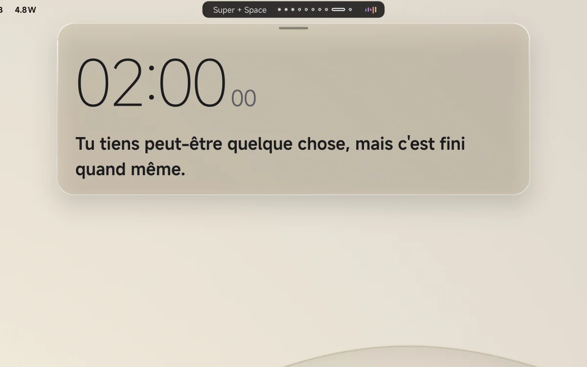

# Veille

A big clock that appears when you're up late, with the occasional message.

<picture><source media="(prefers-color-scheme: dark)" srcset="../screenshots/veille-dark.webp"></picture>

Its settings are in [`quickshell/bar/veille.json`](../../config/hyprland/quickshell/bar/veille.json), and changes apply as soon as you save:

| Key | Controls |
|---|---|
| `enabled`, `language`, `monitor` | On or off, the language of the messages, and which screen it shows on (empty means the focused one) |
| `showSeconds`, `showDate` | How the clock looks |
| `messageIntervalMinutes`, `messageHoldSeconds`, `curatedRatio` | How often messages appear |
| `thresholds` | The time each phase starts |
| `phases` | Whether it shows, and how it looks, in each phase |
| `muteWhileGaming`, `respectZenMode` | When it stays out of the way |

To see it without waiting up, move the shell's clock: `qs -c bar ipc call clock set "02:00"`, or `clock freeze "02:00"` to stop it there. `clock reset` brings back the real time. The bar, the notification centre and the calendar follow, and reminders keep ringing on time.
