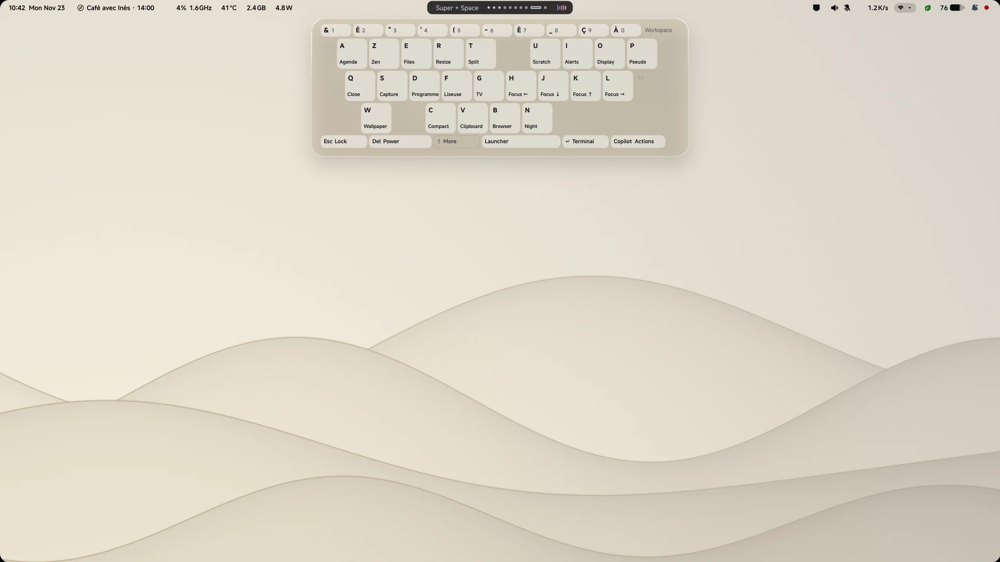
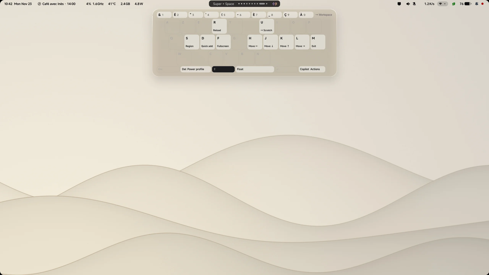

# Key bindings

These are for an AZERTY keyboard. The bindings themselves are defined in [`config/hyprland/hypr/keybinds.lua`](../config/hyprland/hypr/keybinds.lua). In that file, the key names (`ampersand`, `eacute`, …) are the characters the AZERTY number row types, not physical keys 1 to 10.

Hold `Super` and the bar shows the bindings on a keyboard. Add `Shift` for the second layer.

<picture><source media="(prefers-color-scheme: dark)" srcset="screenshots/keybinds-dark.webp"></picture>

<picture><source media="(prefers-color-scheme: dark)" srcset="screenshots/keybinds-shift-dark.webp"></picture>

## Launching

| Binding | Action |
|---|---|
| `Super + Enter` | Terminal (WezTerm by default) |
| `Super + Space` | App launcher (fuzzel) |
| `Super + E` | File manager (Nemo by default) |
| `Super + B` | Web browser (Firefox by default) |
| `Super + W` | Prisme, the wallpaper picker |
| `Super + Shift + W` | [Shell theme](session/theme.md#the-shell-theme): Glass or a cartoon theme, in fuzzel |
| `Super + G` | [Antenne](apps/antenne.md), the TV. Once it's in front, the guide |
| `Super + F` | Liseuse: picks up the book being read, or opens the library to search one. Press `F1` inside a book for its manual |
| `Super + V` | Clipboard history |
| `Super + A` | [Agenda](bar/clock-agenda.md): add or delete an event |
| `Super + D` | Programme's drawer, with the [Programme](bar/programme.md) |
| `Super + Shift + D` | Programme's quick add: an exam, a hand-in, a task or a busy slot in one line |

To open another terminal, file manager or browser, see [default applications](session/hyprland.md#default-applications).

## Screenshots

| Binding | Action |
|---|---|
| `Super + S` | The whole screen, opened in [Screenshot](tools/screenshot.md). `Ctrl + C` or `Enter` copies it |
| `Super + Shift + S` | A dragged region, same keys |
| `q` / `Esc` in Screenshot | Close it |

## Roue, the radial wheels

Press the keys, aim while holding them, and let go to confirm. Or click an action, or pick one with `←` `→` and press `Enter`. `Escape` or a right-click closes the wheel.

| Binding | Wheel |
|---|---|
| `Super + Delete` | Power menu |
| `Super + Shift + Delete` | Power profile |
| `Super + O` | Display layout |
| `Copilot` key | Actions wheel. Press the same key again to close it |

## Windows

| Binding | Action |
|---|---|
| `Super + Q` | Close the window |
| `Super + H` / `J` / `K` / `L` | Focus left / down / up / right |
| `Super + Shift + H/J/K/L` | Move the window in that direction |
| `Super + Shift + F` | Fullscreen |
| `Super + Ctrl + F` | Maximise |
| `Super + Shift + Space` | Float or tile the window |
| `Super + P` | Pseudo-tile |
| `Super + T` | Switch the split direction |
| `Super + R` | Resize mode. Use `H/J/K/L` to resize, and `Escape` or `Enter` to leave |
| `Super + left-drag` | Move the window |
| `Super + right-drag` | Resize the window |

## Workspaces

| Binding | Action |
|---|---|
| `Super + 1..0` | Go to that workspace |
| `Super + Shift + 1..0` | Send the window there |
| `Super + scroll` | Previous / next workspace |
| `Super + C` | Compact the workspaces: the occupied ones move up to fill the gaps |
| `Super + U` | Show or hide the `magic` scratchpad |
| `Super + Shift + U` | Send the window to `magic` |

## Shell and session

| Binding | Action |
|---|---|
| `Super + Z` | Zen mode: hides the bar |
| `Super + N` | Night mode |
| `Super + I` | Notification centre |
| `Super + Escape` | Lock the screen (hyprlock) |
| `Super + Shift + R` | Reload Hyprland's config (`hyprctl reload`) |
| `Super + Shift + M` | Quit Hyprland |

## Media and hardware keys

Mute, mic mute and the playback keys also work while the screen is locked.

| Key | Action |
|---|---|
| Volume up / down | 5 % steps, up to 100 % |
| Mute / mic mute | Mutes, or unmutes |
| Brightness up / down | Never down to 0 |
| Play / pause, previous, next | The player in the bar's island |

## Touchpad

| Gesture | Action |
|---|---|
| Three-finger swipe left or right | Previous / next workspace |
