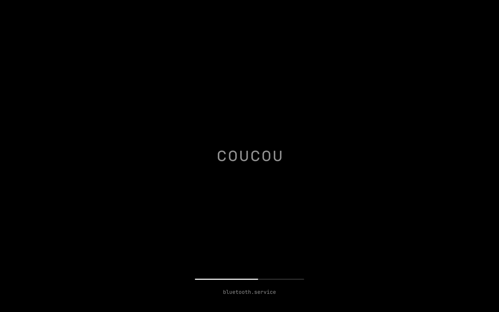

# Boot splash

*Optional.* The boot splash: the word **coucou** on black when the machine starts, **byebye** when it shuts down, with a thin progress bar and the boot log scrolling one line at a time underneath, in JetBrains Mono.

| | |
|:---:|:---:|
|  Boot |  Shutdown |

Installing it selects the theme and rebuilds the initramfs for every installed kernel. Each new kernel is checked as it comes in.

| Tool | Use |
|---|---|
| [`make-assets.py`](../../config/boot/plymouth/make-assets.py) | Regenerates the images. Use `--width` if your screen isn't 1920 px wide |
| [`simulate.py`](../../config/boot/plymouth/simulate.py) | Renders the animation to a video. Takes `--width/--height`, or `--heads 1920x1200,3840x2160` for several screens |
| [`preview.sh`](../../config/boot/plymouth/preview.sh) | Shows the real splash on a spare console. Takes `--sweep`, `--password` and `--status`. It doesn't work on machines whose firmware framebuffer goes away after boot |

The layout and animation are in [`theme/coucou.script`](../../config/boot/plymouth/theme/coucou.script). With several screens, the splash is sized for the smallest one.

If something goes wrong during a real boot, add `plymouth.debug` to the kernel command line and read `/var/log/plymouth-debug.log`.
