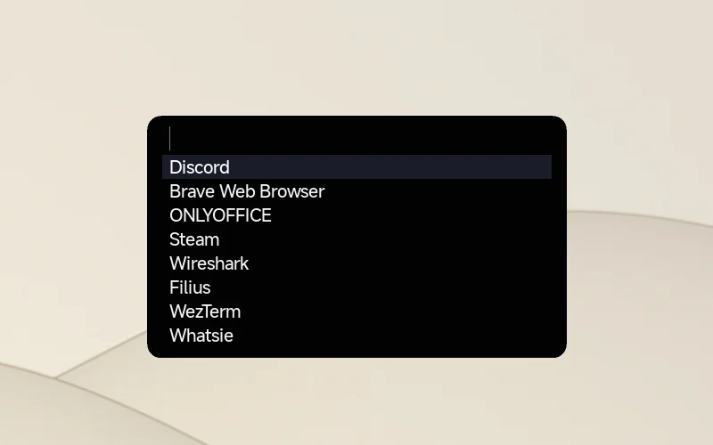

# Launcher and clipboard

fuzzel, the list you type in.

<picture><source media="(prefers-color-scheme: dark)" srcset="../screenshots/launcher-dark.webp"></picture>

| Binding | Opens |
|---|---|
| `Super + Space` | The apps. Type a few letters, `Enter` starts the app |
| `Super + V` | The clipboard history. `Enter` copies the entry again |
| `Super + A` | The [agenda](../bar/clock-agenda.md) |

Its font, size and colours are in [`config/fuzzel/fuzzel.ini`](../../config/fuzzel/fuzzel.ini).
