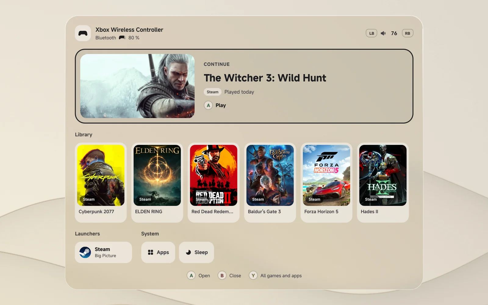
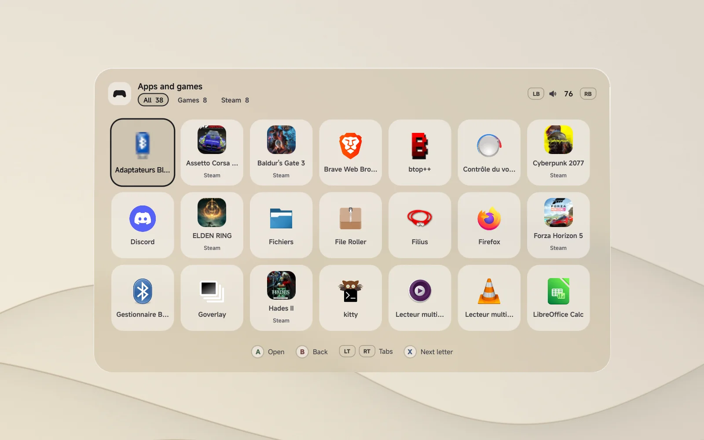
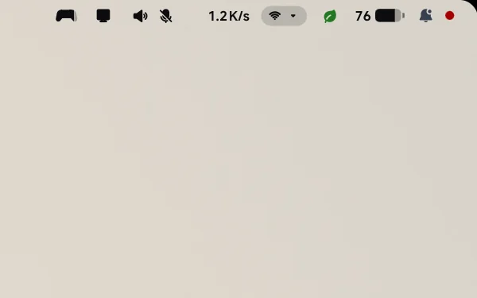
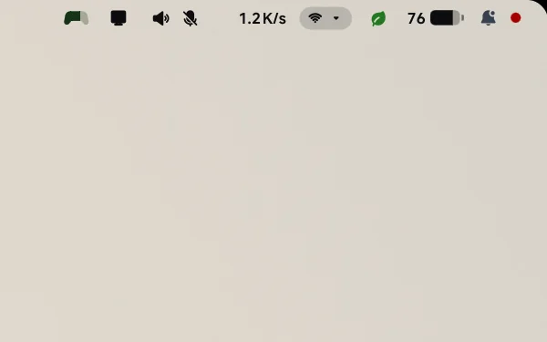

# Manette

Game controllers, and a menu to start your games from the couch.

## Connect a controller

Plug it in, or pair it over Bluetooth. A pill at the bottom of the screen says it's connected.

<picture><source media="(prefers-color-scheme: dark)" srcset="../screenshots/controller-pill-dark.webp"></picture>

Xbox, PlayStation, Switch and Steam controllers work, and any other pad Linux recognises. For an Xbox controller over USB, restart once after installing coucou-shell.

## The menu

Press the **Guide button** (the Xbox, PS or Home logo).

| Row | What it holds |
|---|---|
| **Continue** | The game you played last, with its artwork |
| **Library** | Your other games, Steam and Lutris together, and the games another launcher (Heroic, Bottles, itch…) put in the applications menu |
| **Launchers** | Steam (in Big Picture), Lutris, Heroic, Bottles, itch: the ones installed |
| **System** | Apps, Sleep, and Turn off for a Bluetooth controller |

| | |
|:---:|:---:|
| <picture><source media="(prefers-color-scheme: dark)" srcset="../screenshots/controller-menu-dark.webp"></picture> | <picture><source media="(prefers-color-scheme: dark)" srcset="../screenshots/controller-menu-playstation-dark.webp"></picture> |
| With an Xbox controller | With a PlayStation controller, charging |

The top button opens every app and game in a grid, with a tab for each source.

<picture><source media="(prefers-color-scheme: dark)" srcset="../screenshots/controller-apps-dark.webp"></picture>

Steam and Lutris come with the [`games`](../apps/games.md) unit.

## Buttons

The menu shows your controller's own buttons: letters in their colours on an Xbox pad, the four shapes on a PlayStation one, dots on a pad it doesn't know.

| Button | In the menu |
|---|---|
| D-pad, left stick | Move |
| Bottom button (`A` on Xbox, ✕ on PlayStation, `B` on Switch) | Open |
| Right button (`B`, ○, `A` on Switch) | Back, or close |
| Top button (`Y`, △, `X` on Switch) | All apps and games |
| Left button (`X`, □, `Y` on Switch) | In the grid, next letter |
| Shoulder buttons (`LB` `RB`, `L1` `R1`, `L` `R`) | Volume down, up |
| Triggers (`LT` `RT`, `L2` `R2`, `ZL` `ZR`) | In the grid, previous and next tab |
| Guide | Close |

The keyboard and the mouse work in the menu too: arrows, `Return`, `Esc`. While it's open, the controller drives the menu, not the game behind it.

## Over a game

| Situation | Do |
|---|---|
| Over Steam or a fullscreen game | **Hold Guide** to open the menu. A short press goes to the game |
| A controller without a Guide button | Hold `Select` + `Start` |
| Steam reacts to Guide outside a game | Turn off *Guide button focuses Steam* in Steam's controller settings |

## In the bar

While a controller is connected, its silhouette sits in the bar's right-hand group and fills up like a battery gauge: green while charging, red under 15 %. A wired controller that reports no battery is an outline.

| | |
|:---:|:---:|
| <picture><source media="(prefers-color-scheme: dark)" srcset="../screenshots/bar-controller-dark.webp"></picture> | <picture><source media="(prefers-color-scheme: dark)" srcset="../screenshots/bar-controller-charging-dark.webp"></picture> |
| On battery | Charging |

## Without a controller

To open the menu from a key or a script:

```bash
qs -c bar ipc call bar controllerMenu
```

To see it with a controller you don't have:

```bash
qs -c bar ipc call controller pad xbox 80 false    # or playstation; then its battery, and whether it charges
qs -c bar ipc call controller reset                # remove it
```
