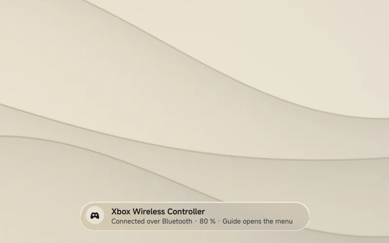

# Manette

Game controllers in the shell. Plug one in or pair it over Bluetooth, and a pill at the bottom of the screen says it's connected. Xbox, PlayStation, Switch and Steam controllers all work, and so does any other pad Linux recognises as one. Over USB, Xbox controllers need the `xpad` driver, which this unit installs (`kernel-modules-extra`): restart once after installing it.

<picture><source media="(prefers-color-scheme: dark)" srcset="../screenshots/controller-pill-dark.webp"></picture>

Press the **Guide button** (the Xbox, PS or Home logo) to open the controller menu:

| Row | What it holds |
|---|---|
| **Continue** | The game you played last, with its artwork. `A` starts it |
| **Library** | Your other games, Steam and Lutris together, plus any game another launcher (Heroic, Bottles, itch…) put in the applications menu |
| **Launchers** | Steam (opens in Big Picture), Lutris, Heroic, Bottles, itch: the ones installed |
| **System** | Apps, Sleep, and Turn off for a Bluetooth controller |

| | |
|:---:|:---:|
| <picture><source media="(prefers-color-scheme: dark)" srcset="../screenshots/controller-menu-dark.webp"></picture> | <picture><source media="(prefers-color-scheme: dark)" srcset="../screenshots/controller-menu-playstation-dark.webp"></picture> |
| With an Xbox controller | With a PlayStation controller, charging |

Games start straight from the menu, without opening Lutris's window. Steam starts quietly in the background, since it must be running for its games. `Y` opens every app and game in a grid, with a tab for each source: `LT` `RT` switch tabs, `X` jumps to the next letter. Steam and Lutris come with the [`games`](../apps/games.md) unit.

<picture><source media="(prefers-color-scheme: dark)" srcset="../screenshots/controller-apps-dark.webp"></picture>

While a controller is connected, its silhouette sits at the start of the bar's right-hand group, next to `hdr`, and fills up like a battery gauge: green while charging, red under 15 %. A wired controller with no battery to report is drawn as an outline.

| | |
|:---:|:---:|
| <picture><source media="(prefers-color-scheme: dark)" srcset="../screenshots/bar-controller-dark.webp"></picture> | <picture><source media="(prefers-color-scheme: dark)" srcset="../screenshots/bar-controller-charging-dark.webp"></picture> |
| On battery | Charging |

The menu shows your controller's own buttons: letters in their colours on an Xbox pad, the four shapes on a PlayStation one, and dots marking the position on a pad it doesn't know.

| Button | In the menu |
|---|---|
| D-pad, left stick | Move |
| Bottom button (`A` on Xbox, ✕ on PlayStation, `B` on Switch) | Open |
| Right button (`B`, ○, `A` on Switch) | Back, or close |
| Top button (`Y`, △, `X` on Switch) | All apps and games |
| Left button (`X`, □, `Y` on Switch) | In the grid, next letter |
| Shoulder buttons (`LB` `RB`, `L1` `R1`, `L` `R`) | Volume down, up |
| Triggers (`LT` `RT`, `L2` `R2`, `ZL` `ZR`) | In the grid, previous and next tab |
| Guide | Close |

While the menu is open, the game behind it receives nothing from the controller. The keyboard and mouse work in it too (arrows, `Return`, `Esc`).

Over Steam or a fullscreen game, a short press on Guide is left to the game: **hold Guide** to open the menu there. A controller without a Guide button opens it with `Select` + `Start` held together. If Steam also reacts to Guide outside a game, turn off *Guide button focuses Steam* in Steam's controller settings.

`qs -c bar ipc call bar controllerMenu` opens or closes the menu without a controller, so you can bind it to a key. To see it with a controller you don't have, `qs -c bar ipc call controller pad xbox 80 false` makes one up (`playstation` for a DualSense, then its battery and whether it charges); `controller reset` removes it.

The service behind it runs as `systemd --user` (`manette.service`). It's built from [`manette-src`](../../config/hyprland/manette-src/) on edge and installed as a package on stable, like Roue, Prisme and Balise.
