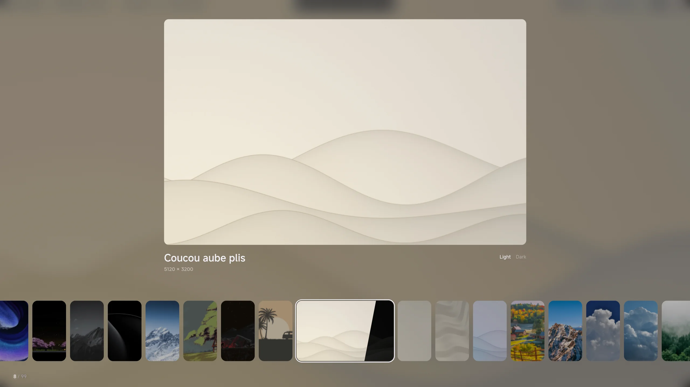

# Prisme

The wallpaper picker, on `Super + W`.

<picture><source media="(prefers-color-scheme: dark)" srcset="../screenshots/prisme-dark.webp"></picture>

The wallpaper you land on shows as a live preview, in the middle of the blurred desktop.

## Keys

| Key | Does |
|---|---|
| `←` `→`, `h` `l` | Previous or next wallpaper |
| `Enter`, `Space` | Sets it |
| `Esc`, `q` | Closes, and keeps the current one |
| `C` | Previews the other version of a light and dark pair |
| `Tab` | Switches between one wallpaper and a slideshow |
| `↓`, `j` | In a slideshow, adds the wallpaper |
| `↑`, `k` | In a slideshow, removes it |

To change them, edit [`prisme/keymap.conf`](../../config/hyprland/prisme/keymap.conf): one line per action, several keys separated by commas. Prisme reads it each time it opens.

## Light and dark pairs

A wallpaper that comes in light and dark is one card. It shows the version for the current mode, and the desktop switches version when you switch mode. To pair your own, see [wallpapers](../session/wallpapers.md#light-and-dark-pairs).

## Settings

All in [`config/hyprland/prisme/`](../../config/hyprland/prisme/), linked at `~/.config/prisme/`:

| File | Sets |
|---|---|
| `wallpapers.conf` | The folder Prisme shows. One path. `~/Images/Wallpapers` when empty, which is rebuilt from the folders below |
| `wallpapers-extra.conf` | Folders of your own to add to it. See [wallpapers](../session/wallpapers.md#add-your-own) |
| `wallpaper-safe-mode.conf` | The wallpapers never to crop. See [wallpapers](../session/wallpapers.md#fitting-to-the-screen) |
| `keymap.conf` | The keys |
| `style.css` | Colours and sizes |
