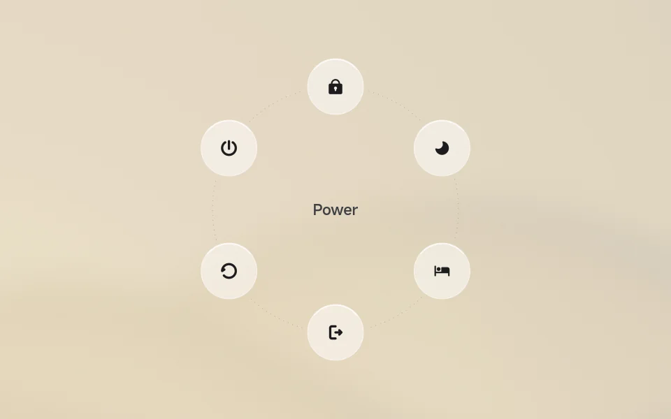

# Roue

A radial wheel: press the keys, aim while you hold them, let go to confirm.

<picture><source media="(prefers-color-scheme: dark)" srcset="../screenshots/roue-dark.webp"></picture>

## The wheels

| Binding | Wheel | Actions |
|---|---|---|
| `Super + Delete` | Power | Lock, sleep, hibernate, log out, restart, shut down |
| `Super + Shift + Delete` | Power profile | Power saver, balanced, performance |
| `Super + O` | Display | Both screens, the laptop's only, the external one only |
| `Copilot` key | Actions | Opens one of the three others. Press the key again to close it |

The power profile wheel also opens from its icon in the bar.

## Use one

- Hold the keys, move the pointer towards an action, let go.
- Or click an action.
- Or pick one with `←` `→` and press `Enter`.
- `Escape` or a right-click closes the wheel.

Sleep, hibernate, log out, restart and shut down ask you to confirm. A dot marks the profile or the display layout in use.

## Change a wheel, or make your own

A wheel is a file in [`config/hyprland/roue/wheels/`](../../config/hyprland/roue/wheels/), linked at `~/.config/roue/wheels/`. `roue <name>` opens `<name>.toml`.

```toml
title = "Power"

[[segment]]
icon = "lock.svg"
label = "Lock"
action = "hyprlock"

[[segment]]
icon = "power.svg"
label = "Shut down"
action = "systemctl poweroff"
confirm = true
confirm_accent = "red"
```

| Key | Use | Default |
|---|---|---|
| `title` | The name shown in the middle | required |
| `icon` | An SVG file from [`roue/icons/`](../../config/hyprland/roue/icons/) | required |
| `label` | The action's name | required |
| `action` | The command to run | required |
| `confirm` | `true` asks to confirm before running | `false` |
| `confirm_accent` | `"red"` turns the Confirm button red | none |

To add an icon, drop an SVG in `roue/icons/`.

`power.toml` and `actions.toml` are yours to edit. `powerprofile.toml` and `display.toml` are written again each time their wheel opens, from the machine's profiles and screens: an edit there is lost.

Bind your own wheel to a key in [`private.lua`](../session/hyprland.md#your-own-rules-and-keys):

```lua
hl.bind("SUPER + G", hl.dsp.exec_cmd("$HOME/.local/bin/roue games"))
```

## Its look

Colours and sizes are in [`roue/style.css`](../../config/hyprland/roue/style.css). The wheel follows light or dark mode.
