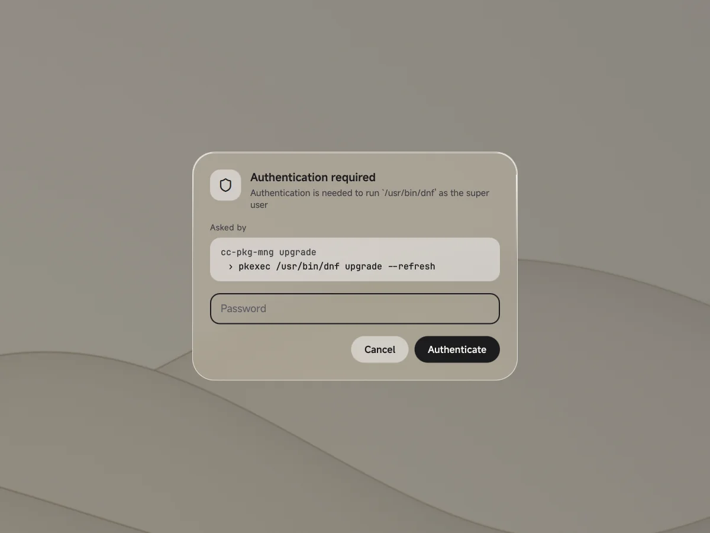

# Sésame

One card, in the middle of the screen, for every password asked outside a terminal. It shows what asks, and which command asked for it.

<picture><source media="(prefers-color-scheme: dark)" srcset="../screenshots/sesame-dark.webp"></picture>

| Who asks | When | The card asks for |
|---|---|---|
| **The system** | An app or a command needs administrator rights: `pkexec`, a service to start, a setting in Balise | The user's password |
| **ssh** | A `git push`, `git pull` or `ssh` to a server, with a passphrase-protected key | The key's passphrase, or a host to trust |
| **git** | Signing in to a remote over HTTPS | User name and password |
| **gpg** | Signing or decrypting with a protected key | The key's passphrase |

`su` and `sudo` ask in the terminal.

## Answer

| Key | Does |
|---|---|
| `Return` | Answers |
| `Esc` | Cancels. The command fails |

While the card is up, it takes the keyboard and the mouse.

Under **Asked by**, the card lists the commands behind the request, the one asking last: `claude › git push origin master › ssh git@github.com …`.

Each `git push` asks again.

## gpg

gpg uses the card unless `gpg-agent.conf` sets a `pinentry-program`.

## Try it

```bash
qs -c bar ipc call bar sesameDemo polkit    # or ssh, gpg, retry, confirm
```

The request is made up.
